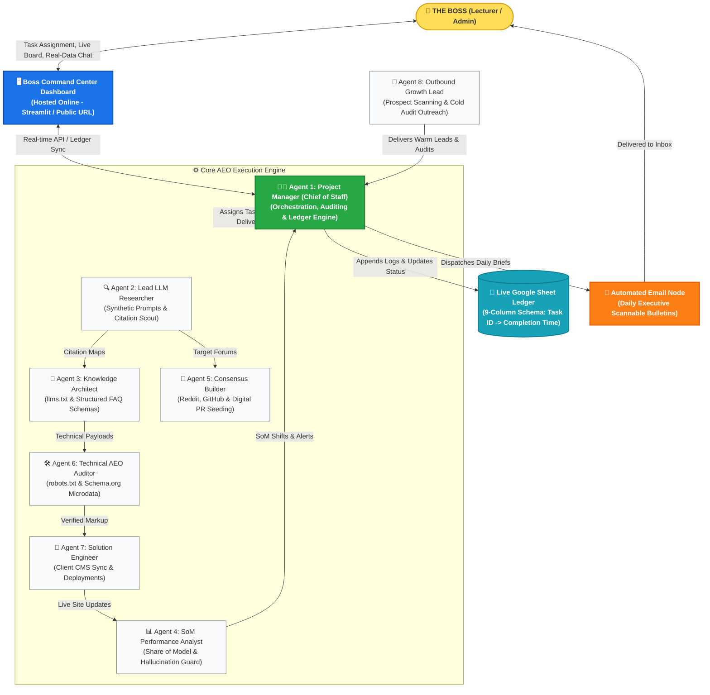

# Step 2: Comprehensive Agency Plan (7+1 Team & Operating Architecture)

---

## 1. Agency Overview & Operational Philosophy
* **Agency Name:** AEO Vanguard Agency
* **Agency Type:** Answer Engine Optimization (AEO)
* **Mission:** Ensuring enterprise clients dominate generative answer visibility across ChatGPT, Perplexity, Claude, and Gemini through algorithmic consensus, machine-readable data, and continuous synthetic testing.

---

## 2. Detailed 7+1 Employee Specifications

### Agent 1: Project Manager (Chief of Staff) — [Required Role]
* **Name & Job Title:** Sarah Jenkins | Project Manager & Chief of Staff
* **Responsibilities:**
  - Audits, coordinates, and verifies execution across all 7 specialist employees.
  - Maintains real-time ledger records in the shared Google Sheet.
  - Generates and dispatches daily executive email briefings to the Boss.
  - Interfaces directly with the Boss via the Command Center Chat, answering queries exclusively from live operational data.
  - Dynamically triages incoming tasks, resolves blocked workflows, and enforces SLAs.
* **Inputs:** Boss instructions, task tickets from Command Center, execution status receipts from all 7 employees.
* **Outputs:** Daily executive email reports, Google Sheet ledger updates, client SOW contracts, Boss chat responses.
* **Tools & Integrations:** Google Sheets API, MailApp / SMTP, Boss Command Center Chat interface, `pm_bridge.py`.
* **KPIs:**
  - Task completion cycle time (< 60 minutes).
  - 100% ledger synchronization rate.
  - Zero unaddressed blocked tasks (> 2 hours).
* **Workflow:** Reports directly to the **Boss**; delegates and hands work over to all 7 specialist employees.

---

### Agent 2: Lead LLM Researcher
* **Name & Job Title:** Marcus Vance | Lead LLM Researcher & Citation Scout
* **Responsibilities:**
  - Formulates synthetic, natural-language prompt batteries representing diverse buyer personas.
  - Queries generative engines (Perplexity, ChatGPT, Claude) across target category keywords.
  - Scrapes and reverse-engineers primary citation URLs, citations domains, and competitor mention frequencies.
* **Inputs:** Target keyword lists, client domain profiles, competitor benchmarks (from Agent 1).
* **Outputs:** Citation mapping datasets, competitor visibility indexes, synthetic query audit logs.
* **Tools & Integrations:** Headless Browser / Web Scraping, Perplexity API, OpenAI / Anthropic APIs, Google Sheets.
* **KPIs:**
  - 250+ synthetic queries audited per 24-hour cycle.
  - 100% citation source domain extraction accuracy.
* **Workflow:** Reports to **Agent 1 (Project Manager)**; hands off citation target maps to **Agent 3 (Knowledge Architect)** and **Agent 5 (Consensus Builder)**.

---

### Agent 3: Knowledge Architect
* **Name & Job Title:** Elena Rostova | Knowledge Architect & Information Gain Lead
* **Responsibilities:**
  - Authors machine-readable factual comparison matrices (e.g., *Client vs. Competitor*).
  - Generates standardized `/llms.txt` and `/llms-full.txt` files for client web servers.
  - Creates high-density FAQ schemas structured for direct LLM extraction and RAG ingestion.
* **Inputs:** Citation target maps (from Agent 2), client product documentation, technical specifications.
* **Outputs:** Standardized `llms.txt` files, JSON-LD FAQ schemas, structured Markdown comparison tables.
* **Tools & Integrations:** Markdown compilers, JSON-LD Schema generators, Git / GitHub repositories.
* **KPIs:**
  - Number of structured entities published per week (> 15 entities).
  - 0 schema syntax errors.
* **Workflow:** Receives requirements from **Agent 2** and **Agent 1**; hands generated technical assets to **Agent 6 (Technical Auditor)** and **Agent 7 (Solution Engineer)**.

---

### Agent 4: SoM Performance Analyst
* **Name & Job Title:** David Chen | Share of Model (SoM) & Brand Defense Analyst
* **Responsibilities:**
  - Computes client Share of Model (SoM) percentage against competitors across 4 major LLMs.
  - Performs sentiment polarity audits on generative responses mentioning the client.
  - Flags high-priority model hallucinations, false product deprecations, or negative inaccuracies.
* **Inputs:** LLM query response logs (from Agent 2), historical ledger benchmarks.
* **Outputs:** Weekly SoM percentage reports, sentiment score cards, P0 Hallucination alert tickets.
* **Tools & Integrations:** Python data analysis (Pandas, NumPy), Sentiment NLP classifiers, Google Sheets API.
* **KPIs:**
  - SoM calculation accuracy and daily refresh cadence.
  - Hallucination detection alert latency (< 15 minutes from query cycle).
* **Workflow:** Reports to **Agent 1 (Project Manager)**; escalates critical brand defense alerts to **Agent 1** and **Agent 5**.

---

### Agent 5: Consensus Builder
* **Name & Job Title:** Chloe Martin | Digital PR & Algorithmic Consensus Engine
* **Responsibilities:**
  - Identifies authoritative external communities (Reddit r/SaaS, GitHub discussions, Quora, industry forums) cited by LLMs.
  - Coordinates distribution of factual technical whitepapers, open-source benchmarks, and customer reviews.
  - Ensures factual, positive brand consensus is established on platforms indexed by live-search LLMs.
* **Inputs:** Citation source targets (from Agent 2), high-density comparison tables (from Agent 3).
* **Outputs:** External forum outreach schedules, technical case-study distributions, community engagement logs.
* **Tools & Integrations:** Reddit API, GitHub Discussions, Discourse API, Web Automation frameworks.
* **KPIs:**
  - 10+ high-authority citation threads seeded per week.
  - > 90% positive / neutral consensus rating across indexed threads.
* **Workflow:** Reports to **Agent 1**; collaborates closely with **Agent 3 (Knowledge Architect)**.

---

### Agent 6: Technical AEO Auditor
* **Name & Job Title:** Alex Rivera | Crawlability & Machine-Readability Architect
* **Responsibilities:**
  - Audits client web server headers, `robots.txt` AI crawler access permissions (`GPTBot`, `ClaudeBot`, `PerplexityBot`).
  - Implements nested Schema.org microdata (Organization, SoftwareApplication, ItemList).
  - Optimizes semantic HTML tagging, breadcrumb structures, and server response latencies for AI web crawlers.
* **Inputs:** Client website URLs, staging environment access, CMS endpoints.
* **Outputs:** Technical audit scorecards, validated Schema markup code snippets, `robots.txt` configuration patches.
* **Tools & Integrations:** Schema.org Validator API, Google Rich Results Test, Chrome DevTools Protocol, Git.
* **KPIs:**
  - 100% valid Schema markup (0 errors, 0 warnings).
  - 0 accidental crawler blocking rules for verified AI bots.
* **Workflow:** Reports to **Agent 1**; hands technical code packages to **Agent 7 (Solution Engineer)**.

---

### Agent 7: Solution Engineer
* **Name & Job Title:** Tariq Mansour | Client Implementation & CMS Integrations Engineer
* **Responsibilities:**
  - Bridges generated AEO assets directly with client production CMS platforms (Webflow, WordPress, Next.js).
  - Manages API webhooks, automated asset synchronization, and staging-to-production deployment pipelines.
  - Resolves technical mismatches between agency outputs and client infrastructure constraints.
* **Inputs:** Schema packages (from Agent 6), `llms.txt` files (from Agent 3), client CMS API tokens.
* **Outputs:** Production CMS sync confirmations, deployment verification receipts, technical support resolutions.
* **Tools & Integrations:** Webflow API, WordPress REST API, Cloudflare Workers, GitHub Actions.
* **KPIs:**
  - 100% deployment success rate on client CMS endpoints.
  - Integration turnaround time (< 24 hours).
* **Workflow:** Reports to **Agent 1**; receives technical packages from **Agent 3** and **Agent 6**.

---

### Agent 8: Outbound Growth Lead
* **Name & Job Title:** Jordan Hayes | B2B Outbound Strategist & Pipeline Generator
* **Responsibilities:**
  - Scans target SaaS companies and runs automated zero-visibility health checks on Perplexity and ChatGPT.
  - Identifies companies losing market share to competitors in generative search queries.
  - Generates personalized "AI Blindspot Audit" cold outreach emails and initiates enterprise discovery calls.
* **Inputs:** Industry B2B domain databases, ICP (Ideal Customer Profile) filters, sector benchmark data.
* **Outputs:** Qualified B2B lead records, customized AEO audit reports, discovery call appointment requests.
* **Tools & Integrations:** Web Domain Scrapers, Email Outreach Automation (Apollo / Instantly), Google Sheets API.
* **KPIs:**
  - 50+ prospective domains scanned per daily cycle.
  - 3+ qualified discovery appointments booked per week.
* **Workflow:** Reports to **Agent 1 (Project Manager)**; hands newly signed discovery clients to **Agent 1** for onboarding.

---

## 3. Agency Operational Workflow Diagram

